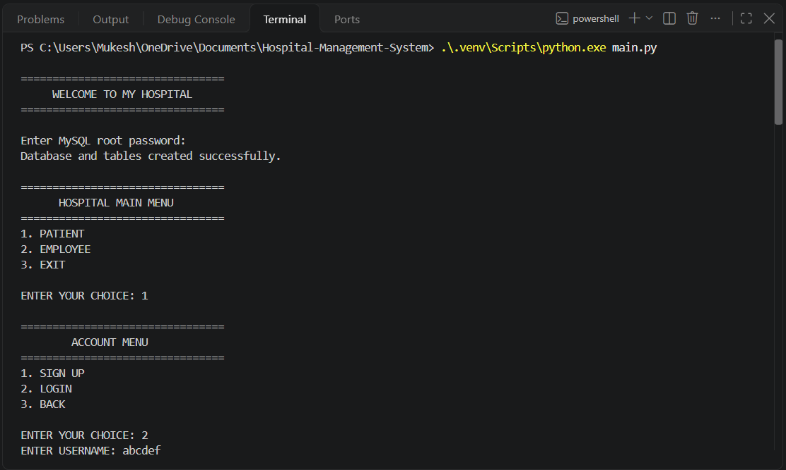
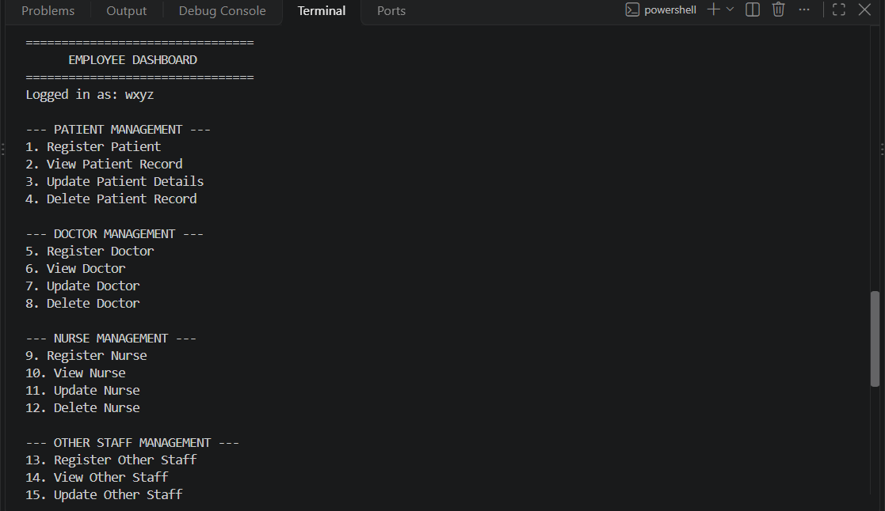
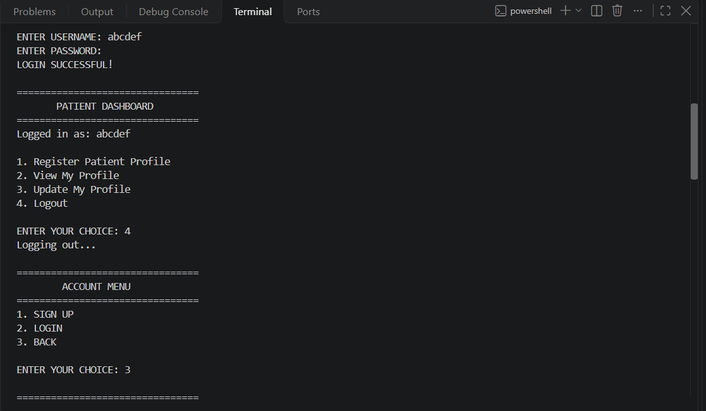

# Hospital Management System

A Python-based Hospital Management System using MySQL for database storage and a command-line interface for managing hospital records.

## Features

- User registration and login
- Role-based access for patients and employees
- Secure password hashing
- Patient record management (CRUD)
- Doctor record management (CRUD)
- Nurse record management (CRUD)
- Other hospital staff management (CRUD)
- Medicine inventory management
- MySQL database integration

## Technologies Used

- Python
- MySQL
- MySQL Connector/Python
- SQL

## Project Structure

- `main.py` – Main application and menu system
- `.gitignore` – Excludes unnecessary and sensitive files

## Setup

1. Install Python.
2. Install MySQL Server.
3. Install the MySQL connector:

   `pip install mysql-connector-python`

4. Run the application:

   `python main.py`

## Purpose

This project was developed to practice Python programming, database connectivity, SQL queries, CRUD operations, authentication, and modular menu-driven application development.

## Disclaimer

This is an educational project and is not intended for real hospital use or storage of actual patient information.

## Application Screenshots

### Login and Welcome Screen

### Employee Dashboard

### Patient Dashboard
